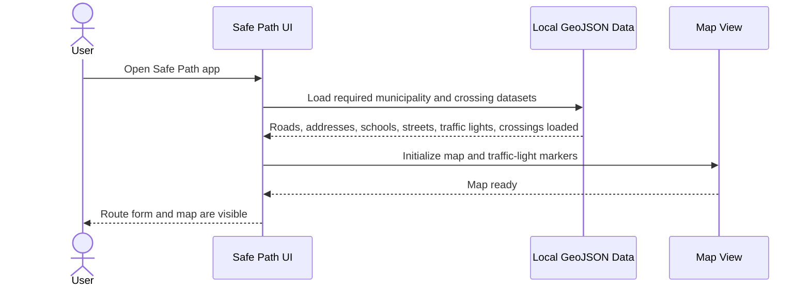
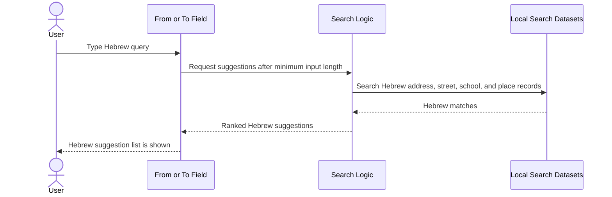
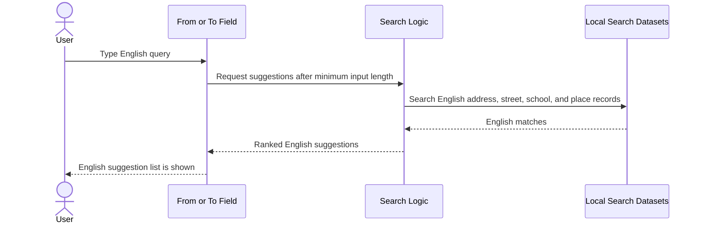
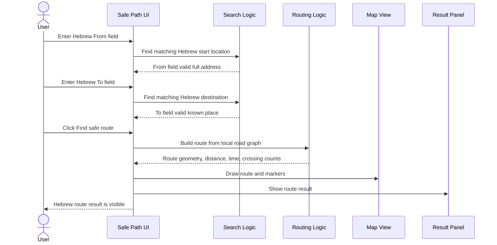
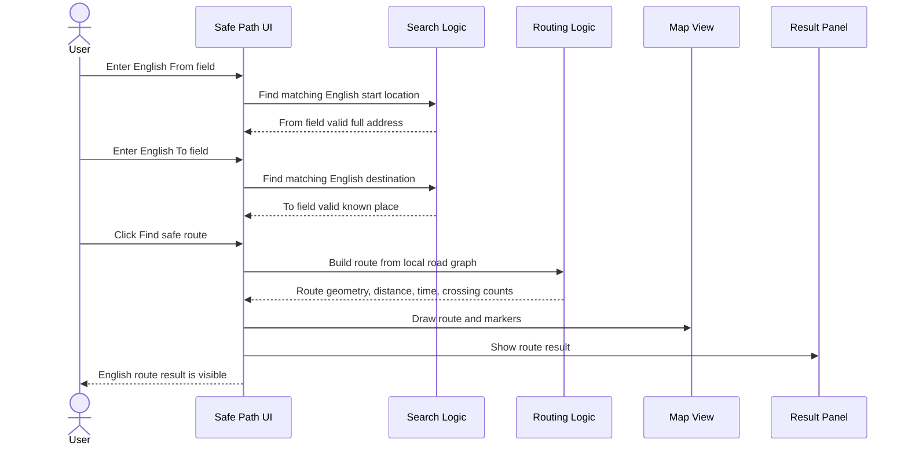
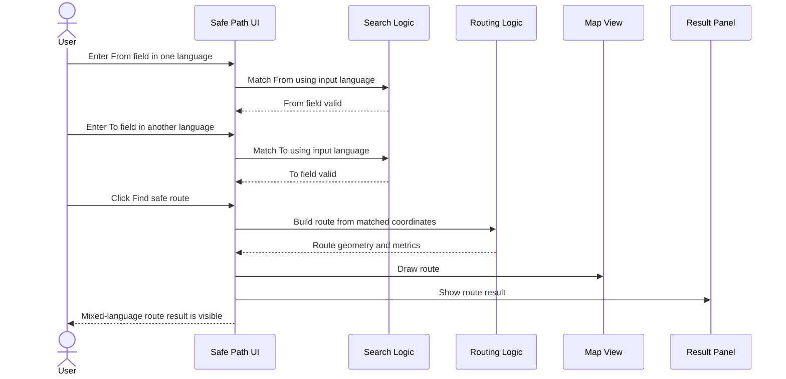
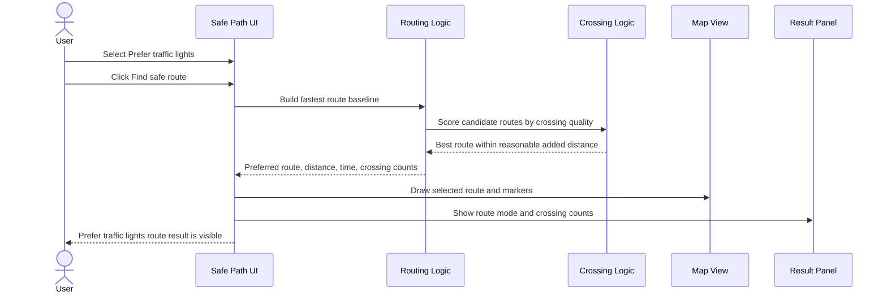
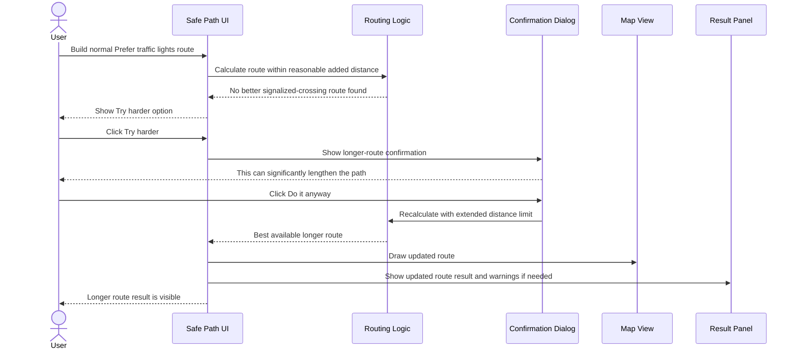
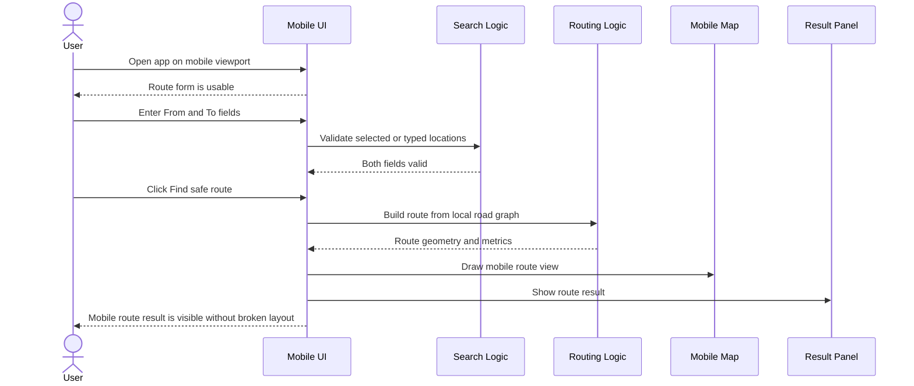

# Safe Path Happy Path Flows

This document describes the successful end-to-end user flows for Safe Path. It is a QA and product reference: every flow should stay aligned with `docs/spec.md` and the automated test coverage.

Update this file when:

- the product spec changes;
- address search behavior changes;
- route-building logic changes;
- route result fields change;
- web or mobile UI flow changes;
- happy-path test fixtures change.

## Flow Index

| Flow ID | Flow | Priority | Main Spec Section | Example Fixture | Automation Coverage |
| --- | --- | --- | --- | --- | --- |
| HP-FLOW-001 | App loads with map and route form | P0 | `2. Release Scope`, `10. Map Requirements` | Open app | Playwright |
| HP-FLOW-002 | Hebrew autocomplete returns Hebrew options | P0 | `5. Address And Place Search` | `נמי` -> `נמיר` | Playwright |
| HP-FLOW-003 | English autocomplete returns English options | P0 | `5. Address And Place Search` | `nami` -> `NAMIR` | Playwright |
| HP-FLOW-004 | Hebrew to Hebrew route is built | P0 | `4. Core User Flow`, `7. Routing Model` | `אבן גבירול 71` -> `נמל תל אביב` | Playwright |
| HP-FLOW-005 | English to English route is built | P0 | `4. Core User Flow`, `7. Routing Model` | `IBN GVIROL 71` -> `Tel Aviv Port` | Playwright |
| HP-FLOW-006 | Mixed-language route is built | P1 | `5. Address And Place Search`, `7. Routing Model` | `אבן גבירול 71` -> `Tel Aviv Port` | Playwright |
| HP-FLOW-007 | Prefer traffic lights route is built | P0 | `6. Route Modes`, `8. Crossing Logic` | Valid From and To with route mode `Prefer traffic lights` | Vitest + Playwright |
| HP-FLOW-008 | Try harder builds a longer traffic-light route after confirmation | P0 | `9. Try Harder Flow` | `סמטת החרמון 7` -> `כפר גלעדי 32` | Playwright |
| HP-FLOW-009 | Mobile route flow works | P0 | `2. Release Scope`, `4. Core User Flow` | Mobile viewport route fixture | Playwright |

## HP-FLOW-001: App Loads With Map And Route Form

Related spec sections:

- `2. Release Scope`
- `10. Map Requirements`
- `15. Acceptance Criteria`

Expected successful end state:

- From and To fields are visible.
- Route mode control is visible.
- `Find safe route` action is available.
- Map is visible.
- Traffic-light markers are visible when data is loaded.

## HP-FLOW-002: Hebrew Autocomplete Returns Hebrew Options

Related spec sections:

- `5. Address And Place Search`
- `15. Acceptance Criteria > Search`

Example fixture:

- User types `נמי`.
- Expected option includes Hebrew `נמיר`.

Expected successful end state:

- Hebrew suggestions are shown for Hebrew input.
- English suggestions do not replace Hebrew results when Hebrew matches exist.
- User can select one suggestion.

## HP-FLOW-003: English Autocomplete Returns English Options

Related spec sections:

- `5. Address And Place Search`
- `15. Acceptance Criteria > Search`

Example fixture:

- User types `nami`.
- Expected option includes English `NAMIR`.

Expected successful end state:

- English suggestions are shown for English input.
- Hebrew suggestions do not replace English results when English matches exist.
- User can select one suggestion.

## HP-FLOW-004: Hebrew To Hebrew Route Is Built

Related spec sections:

- `4. Core User Flow`
- `5. Address And Place Search`
- `7. Routing Model`
- `11. Result Panel Requirements`

Example fixture:

- From: `אבן גבירול 71`
- To: `נמל תל אביב`

Expected successful end state:

- Route line is shown on the map.
- Start and destination markers are shown.
- Result panel shows distance and estimated walking time.
- Result panel shows route mode and crossing counts.

## HP-FLOW-005: English To English Route Is Built

Related spec sections:

- `4. Core User Flow`
- `5. Address And Place Search`
- `7. Routing Model`
- `11. Result Panel Requirements`

Example fixture:

- From: `IBN GVIROL 71`
- To: `Tel Aviv Port`

Expected successful end state:

- English input can produce a valid route.
- Route distance is calculated from graph edges.
- Walking time is calculated from route distance.

## HP-FLOW-006: Mixed-Language Route Is Built

Related spec sections:

- `5. Address And Place Search`
- `7. Routing Model`
- `15. Acceptance Criteria > Search`

Example fixtures:

- Hebrew to English: `אבן גבירול 71` -> `Tel Aviv Port`
- English to Hebrew: `IBN GVIROL 71` -> `נמל תל אביב`

Expected successful end state:

- Each field respects its own input language.
- Mixed language input works when it reflects real user input.
- Route result is not blocked because the two fields use different languages.

## HP-FLOW-007: Prefer Traffic Lights Route Is Built

Related spec sections:

- `6. Route Modes`
- `8. Crossing Logic`
- `11. Result Panel Requirements`
- `15. Acceptance Criteria > Routing`

Expected successful end state:

- Only one route mode is active.
- Prefer traffic lights uses crossing quality and distance limit.
- Result panel shows signalized and non-signalized crossing counts.
- If crossing data is used, user sees the crossing-data warning before route result details.

## HP-FLOW-008: Try Harder Builds A Longer Traffic-Light Route After Confirmation

Related spec sections:

- `8. Crossing Logic`
- `9. Try Harder Flow`
- `12. Error States`
- `15. Acceptance Criteria > Routing`

Example fixture:

- From: `סמטת החרמון 7`
- To: `כפר גלעדי 32`

Expected successful end state:

- `Try harder` requires confirmation.
- Extended route does not exceed the defined maximum distance limit.
- If the route still includes crossings without traffic lights, the UI clearly warns the user.

## HP-FLOW-009: Mobile Route Flow Works

Related spec sections:

- `2. Release Scope`
- `4. Core User Flow`
- `10. Map Requirements`
- `15. Acceptance Criteria > UI`

Expected successful end state:

- Form controls are usable on mobile width.
- Route is calculated and drawn.
- Result content is visible without overlap.
- Map and result remain readable on mobile viewport.
